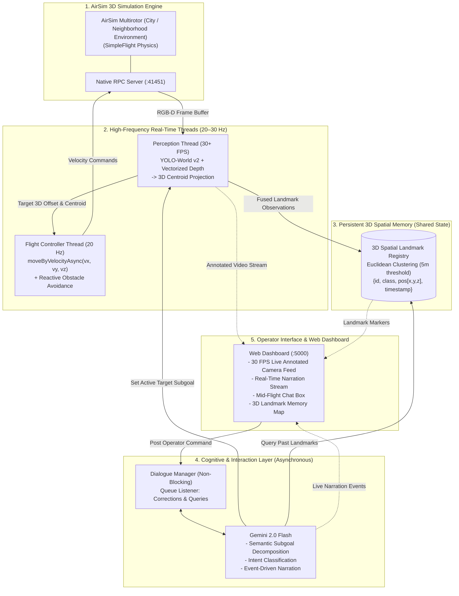
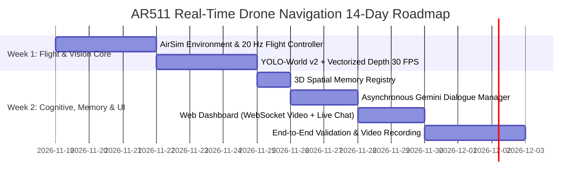

# Real-Time Autonomous Drone Navigation — Implementation Plan

## Goal Description

Build a **truly real-time, continuous-flight autonomous drone navigation system** for the **AR511 course project** (Dharmesh Sahu & Mihir Yadav) operating in an AirSim 3D city environment.

The system replaces the legacy turn-based discrete stepping of academic benchmarks with an **asynchronous hierarchical real-time architecture**:
1. **Continuous Flight Controller (20–30 Hz)**: Smooth velocity-vector flight via AirSim's native `moveByVelocityAsync` with reactive depth-based obstacle avoidance.
2. **Real-Time Edge Perception (30+ FPS)**: Open-vocabulary zero-shot landmark detection using YOLO-World (`yolov8s-worldv2`) on the RTX 3060, coupled with vectorized NumPy 3D depth back-projection (<0.2 ms).
3. **Asynchronous Cognitive Guidance (Gemini 2.0 Flash)**: Non-blocking background worker for natural-language instruction decomposition and real-time dialogue interruption handling.
4. **Persistent 3D Spatial Memory**: Dynamic spatial landmark registry with Euclidean clustering that remembers previously seen landmarks and supports return-to-past queries.
5. **Explainability Layer & Web Dashboard**: Live event-driven rationale narration and front-camera video streaming over WebSocket to a single-page web UI.

---

## Architectural Verdict: Why Clean Modular Architecture (Option B) Wins

A deep codebase inspection of `EmbodiedCity/CityNavAgent.code` revealed that hacking its existing `SimRun.py` is impossible for real-time flight:

| CityNavAgent Reality | Real-Time System Requirement | Clean Modular Architecture (Option B) |
|---|---|---|
| **No Flight Physics**: `"SimMode": "ComputerVision"` — teleports coordinates via `simSetVehiclePose`. | Continuous multirotor aerodynamics & smooth motion at 20–30 Hz. | Native `airsim.MultirotorClient` using `moveByVelocityAsync` with SimpleFlight physics. |
| **8–14 Seconds per Step**: Halts, teleports 8 times in a circle for a panorama, disk thrashing to `/tmp/`, slow API calls. | 30+ FPS continuous camera feed and sub-50 ms perception cycles. | In-memory frame queries (`simGetImages`), zero disk writes, 30+ FPS live pipeline. |
| **636M Heavy Perception**: GroundingDINO + SAM ViT-H takes 2–4s per frame; submodules missing from repo. | Sub-20 ms open-vocabulary landmark detection on RTX 3060. | **YOLO-World v2 FP16** (12–15 ms per frame) via Ultralytics. |
| **Unvectorized 262k Pixel Loops**: `maps.py` iterates pixel-by-pixel in Python taking 3–5 seconds. | Real-time 3D coordinate projection (<1 ms). | **Vectorized NumPy pinhole projection** (<0.2 ms). |
| **Cheats via Pre-baked JSON**: Reads offline dataset files (`_landmk.json`); cannot parse live text online. | Live free-form natural language instructions and mid-flight voice/text corrections. | **Asynchronous Gemini 2.0 Flash** parser & Dialogue Manager. |

### Logic Reused from CityNavAgent:
1. **Landmark Extraction Prompt Concepts**: High-level semantic decomposition logic adapted from `utils/landmark_extraction.py`.
2. **Pinhole Camera Intrinsics**: Focal length math $f_x = \frac{W}{2\tan(\text{FOV}/2)}$ from `utils/maps.py`, fully vectorized in NumPy.

---

## System Architecture



---

## File Structure & Proposed Changes

All code will be organized in a clean, self-contained Python package:

```
realtime_citynav/
├── main.py                         # Application entrypoint & thread orchestrator
├── config.py                       # Configuration (AirSim IP, camera FOV, thresholds, Gemini API key)
├── flight_controller.py            # 20 Hz continuous velocity flight loop & APF obstacle avoidance
├── perception.py                   # 30 FPS YOLO-World detector & vectorized 3D depth projection
├── spatial_memory.py               # 3D persistent landmark registry with Euclidean clustering
├── dialogue_manager.py             # Asynchronous operator command queue & intent classifier
├── explainability.py               # Event-driven narration generator (Gemini 2.0 Flash)
└── dashboard/
    ├── app.py                      # FastAPI / Flask WebSocket streaming server
    └── templates/
        └── index.html              # Modern dark-mode UI with live feed, chat, and telemetry
```

---

### Component Implementation Details

#### 1. [NEW] `perception.py` — Real-Time 30+ FPS Open-Vocabulary Perception
Uses YOLO-World v2 with vectorized depth back-projection:
```python
import numpy as np
import cv2
from ultralytics import YOLO

class RealtimePerception:
    def __init__(self, fov=90.0, width=640, height=480, device="cuda"):
        self.model = YOLO("yolov8s-worldv2.pt").to(device)
        self.width, self.height = width, height
        
        # Vectorized Pinhole Camera Intrinsics (from CityNavAgent math)
        self.fx = width / (2.0 * np.tan(np.deg2rad(fov) / 2.0))
        self.fy = height / (2.0 * np.tan(np.deg2rad(fov) / 2.0))
        self.cx, self.cy = width / 2.0, height / 2.0

        # Precompute coordinate grids for instant projection (<0.2 ms)
        u, v = np.meshgrid(np.arange(width), np.arange(height))
        self.u_factor = (u - self.cx) / self.fx
        self.v_factor = (v - self.cy) / self.fy

    def update_target_vocabulary(self, class_names: list[str]):
        """Dynamically update zero-shot detection vocabulary"""
        self.model.set_classes(class_names)

    def detect_and_project(self, rgb_img: np.ndarray, depth_img: np.ndarray, drone_pose: tuple):
        """
        Runs YOLO-World inference (~12ms) and projects bounding box centroids to 3D world coords.
        Returns: list of dicts: {'name': str, 'conf': float, 'bbox': [x1,y1,x2,y2], 'world_pos': [X,Y,Z]}
        """
        results = self.model.predict(rgb_img, conf=0.25, verbose=False)[0]
        detections = []

        drone_x, drone_y, drone_z, yaw = drone_pose
        cos_y, sin_y = np.cos(yaw), np.sin(yaw)

        for box in results.boxes:
            x1, y1, x2, y2 = map(int, box.xyxy[0].tolist())
            u_c, v_c = (x1 + x2) // 2, (y1 + y2) // 2
            
            # Median depth in 5x5 patch around centroid (robust against edge noise)
            patch = depth_img[max(0, v_c-2):min(self.height, v_c+3), max(0, u_c-2):min(self.width, u_c+3)]
            valid_depth = patch[patch > 0.5]
            if len(valid_depth) == 0:
                continue
            z_metric = float(np.median(valid_depth))
            if z_metric > 80.0:  # Ignore sky / infinite horizon
                continue

            # Camera frame coords: X_cam=right, Y_cam=down, Z_cam=forward
            x_cam = (u_c - self.cx) * z_metric / self.fx
            y_cam = (v_c - self.cy) * z_metric / self.fy
            z_cam = z_metric

            # Transform from AirSim Camera to Body (Forward, Right, Down)
            x_body = z_cam
            y_body = x_cam
            z_body = y_cam

            # Rotate by drone yaw into World NED coordinates
            x_world = drone_x + (x_body * cos_y - y_body * sin_y)
            y_world = drone_y + (x_body * sin_y + y_body * cos_y)
            z_world = drone_z + z_body

            class_id = int(box.cls[0])
            name = results.names[class_id]
            detections.append({
                "name": name,
                "conf": float(box.conf[0]),
                "bbox": [x1, y1, x2, y2],
                "world_pos": np.array([x_world, y_world, z_world])
            })
        return detections
```

#### 2. [NEW] `flight_controller.py` — Continuous 20 Hz Flight Loop
Smooth velocity control without pausing or discrete teleportation:
```python
import airsim
import numpy as np
import time

class RealtimeFlightController:
    def __init__(self, ip="127.0.0.1", cruise_speed=4.0):
        self.client = airsim.MultirotorClient(ip=ip)
        self.client.confirmConnection()
        self.client.enableApiControl(True)
        self.client.armDisarm(True)
        self.cruise_speed = cruise_speed
        self.target_position = None
        self.is_running = False

    def takeoff(self, altitude=5.0):
        self.client.takeoffAsync().join()
        self.client.moveToZAsync(-altitude, 2.0).join()

    def set_target(self, world_xyz: np.ndarray):
        self.target_position = world_xyz

    def compute_obstacle_repulsion(self, depth_img: np.ndarray) -> np.ndarray:
        """Reactive depth safety field: steers away from central obstacles < 4m"""
        h, w = depth_img.shape
        center_roi = depth_img[h//4: 3*h//4, w//4: 3*w//4]
        close_mask = (center_roi > 0.2) & (center_roi < 4.0)
        if np.mean(close_mask) > 0.15:  # Significant obstacle ahead
            # Steer horizontally away from dense obstacle region
            left_half = np.mean((center_roi[:, :w//4] < 4.0))
            right_half = np.mean((center_roi[:, w//4:] < 4.0))
            repulsion_y = 2.0 if left_half > right_half else -2.0
            return np.array([-1.5, repulsion_y, 0.0])  # Back off and slide
        return np.zeros(3)

    def step_control(self, current_pose: tuple, depth_img: np.ndarray):
        """Runs at 20 Hz: calculates smooth velocity vector and calls moveByVelocityAsync"""
        curr_pos = np.array(current_pose[:3])
        curr_yaw = current_pose[3]

        if self.target_position is not None:
            delta = self.target_position - curr_pos
            dist = np.linalg.norm(delta[:2])
            if dist > 1.5:
                # Proportional guidance velocity
                direction = delta / np.linalg.norm(delta)
                v_des = direction * min(self.cruise_speed, dist * 1.2)
            else:
                v_des = np.zeros(3)  # Hover at target
        else:
            # Default forward search cruise
            v_des = np.array([self.cruise_speed * np.cos(curr_yaw), self.cruise_speed * np.sin(curr_yaw), 0.0])

        # Add reactive obstacle avoidance
        v_rep = self.compute_obstacle_repulsion(depth_img)
        v_cmd = v_des + v_rep

        # Send continuous non-blocking velocity command for 100ms
        self.client.moveByVelocityAsync(float(v_cmd[0]), float(v_cmd[1]), float(v_cmd[2]), duration=0.1)
```

#### 3. [NEW] `spatial_memory.py` — 3D Persistent Spatial Landmark Map
```python
import numpy as np
import time

class SpatialMemory:
    def __init__(self, cluster_threshold=5.0):
        self.cluster_threshold = cluster_threshold
        self.landmarks = {}  # id -> {name, pos, first_seen, last_seen, count}
        self.next_id = 0

    def add_observations(self, detections: list):
        for det in detections:
            name, pos = det["name"], det["world_pos"]
            matched_id = None
            for lid, info in self.landmarks.items():
                if info["name"] == name and np.linalg.norm(info["pos"] - pos) < self.cluster_threshold:
                    matched_id = lid
                    break

            now = time.time()
            if matched_id is not None:
                # Update running average position and timestamp
                old = self.landmarks[matched_id]
                old["pos"] = 0.8 * old["pos"] + 0.2 * pos
                old["last_seen"] = now
                old["count"] += 1
            else:
                self.landmarks[self.next_id] = {
                    "id": self.next_id,
                    "name": name,
                    "pos": pos,
                    "first_seen": now,
                    "last_seen": now,
                    "count": 1
                }
                self.next_id += 1

    def find_landmark(self, query_name: str) -> dict | None:
        """Finds closest matching landmark by name"""
        matches = [info for info in self.landmarks.values() if query_name.lower() in info["name"].lower()]
        if not matches:
            return None
        return max(matches, key=lambda x: x["count"])

    def get_summary(self) -> str:
        if not self.landmarks:
            return "No landmarks recorded yet."
        return "\n".join([f"- {l['name']} (ID {l['id']}) at [{l['pos'][0]:.1f}, {l['pos'][1]:.1f}, {l['pos'][2]:.1f}], observed {l['count']} times" for l in self.landmarks.values()])
```

#### 4. [NEW] `dialogue_manager.py` — Asynchronous Dialogue & Interruption
```python
from google import genai
import json, queue

class DialogueManager:
    def __init__(self, api_key: str):
        self.client = genai.Client(api_key=api_key)
        self.command_queue = queue.Queue()

    def queue_user_message(self, text: str):
        self.command_queue.put(text)

    def parse_initial_instruction(self, instruction: str) -> list[str]:
        """Decomposes natural language instruction into ordered landmark classes"""
        prompt = f"""Decompose this drone navigation instruction into an ordered list of landmark targets:
Instruction: "{instruction}"
Respond strictly with JSON: {{"subgoals": ["fountain", "red building", "tower"]}}"""
        resp = self.client.models.generate_content(
            model="gemini-2.0-flash", contents=prompt, config={"response_mime_type": "application/json"}
        )
        return json.loads(resp.text).get("subgoals", [])

    def process_interruption(self, current_target: str, memory_summary: str):
        if self.command_queue.empty():
            return None
        msg = self.command_queue.get_nowait()
        prompt = f"""An operator interrupted the drone flight.
Current target: "{current_target}"
Known landmarks:
{memory_summary}

Operator message: "{msg}"

Classify into one of:
- "TARGET_CORRECTION": operator changes the current target (e.g., "no, the blue building")
- "RETURN_TO_PAST": operator wants to go back to an earlier landmark (e.g., "go back to the fountain")
- "QUERY": operator asks what has been seen (e.g., "what have you seen?")

Respond with JSON:
{{"intent": "TARGET_CORRECTION", "new_target": "blue building", "reply": "Understood. Switching target to blue building."}}"""
        resp = self.client.models.generate_content(
            model="gemini-2.0-flash", contents=prompt, config={"response_mime_type": "application/json"}
        )
        return json.loads(resp.text)
```

---

## 14-Day Day-by-Day Timeline



---

## Work Division (Dharmesh Sahu & Mihir Yadav)

| Component | Dharmesh Sahu (B24033, SBB) | Mihir Yadav (B24341, SCEE) |
|---|---|---|
| **Simulation & Flight Control** | 20 Hz velocity tracker, guidance algorithms | AirSim setup, environment testing, safety boundaries |
| **Real-Time Vision** | Vectorized 3D projection, depth centroid filtering | YOLO-World installation, test prompts & weights |
| **Cognitive & Memory** | Gemini 2.0 Flash prompt design, dialogue queue | 3D spatial memory clustering, query endpoints |
| **Dashboard & Demo** | Backend WebSocket event streaming | Frontend HTML/CSS dashboard, video recording |

---

## Verification Plan

### Automated Benchmarks
```bash
# 1. Test YOLO-World inference latency on RTX 3060 (must be <20ms)
python -c "import time, torch, numpy as np; from ultralytics import YOLO; m=YOLO('yolov8s-worldv2.pt').to('cuda'); m.set_classes(['building', 'car']); img=np.zeros((480,640,3), dtype=np.uint8); t0=time.time(); [m.predict(img, verbose=False) for _ in range(50)]; print(f'Avg FPS: {50/(time.time()-t0):.1f}')"

# 2. Test vectorized depth projection latency (must be <1ms)
python -c "import time, numpy as np; u, v = np.meshgrid(np.arange(640), np.arange(480)); z = np.random.rand(480, 640); t0=time.time(); [(u*z, v*z) for _ in range(100)]; print(f'Avg latency: {(time.time()-t0)/100*1000:.3f} ms')"
```

### Manual Flight Verification Scenarios
1. **Continuous Flight Check**: Drone takes off, accelerates smoothly to 4 m/s, tracks a visible landmark, and slows to a hover upon arrival without pausing.
2. **Reactive Obstacle Avoidance**: Fly drone toward an urban obstacle; verify the depth repulsion field automatically steers it laterally.
3. **Mid-Flight Interruption**: Type *"no, the blue building"* into the dashboard while flying toward a red building; verify the drone turns smoothly in real time without stopping.
4. **Memory Return**: After passing a fountain, type *"go back to the fountain"*; verify the drone queries spatial memory and navigates back to the recorded coordinates.
